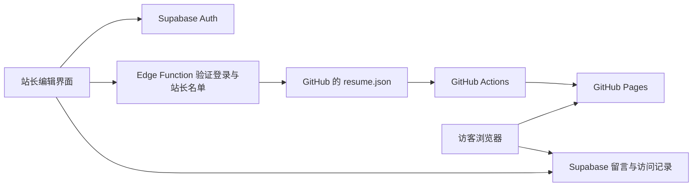

# 在线简历后台：架构与首次接入

## 各部分负责什么

| 部分 | 职责 |
| --- | --- |
| GitHub 仓库 `oii2659/profile` | 保存网站源代码、简历内容、每次修改的历史版本 |
| GitHub Actions | 源文件提交后，检查并编译网站，再部署 |
| GitHub Pages | 把网页、样式、JavaScript、照片等静态文件发给访客的浏览器 |
| 浏览器中的 Vue 网站 | 展示简历、留言板，以及站长登录和编辑界面 |
| Supabase Auth | 验证站长邮箱与密码，签发登录凭证 |
| Supabase Database + RLS | 保存留言、站长名单、访问记录，并限制谁能读写 |
| Supabase Edge Function | 验证管理员身份，持有 GitHub 凭据，只更新指定简历内容文件 |
| 自定义域名（可选） | 让访问者用自己的域名进入 GitHub Pages，不改变以上数据存储方式 |

GitHub 和 Supabase 背后都由服务器运行，但这里 GitHub Pages 承担静态托管，Supabase 承担应用后端。无需另买一台服务器来运行这套后台。



简历内容的唯一来源是 `src/data/resume.json`。基本信息是结构化字段，两页正文是经过白名单清理的富文本 HTML。页面布局、字体和照片仍由 Vue/CSS/本地资源管理。保存不会改变任意组件或工作流代码，只会修改这个内容文件。GitHub 有新提交后，本地项目需要 `git pull` 才能同步。

## 1. 确认项目连接

在 Supabase Dashboard 找到项目 URL 和 publishable / anon key，配置本地 `.env.local` 与 GitHub 仓库 Actions Secrets：

```dotenv
VITE_SUPABASE_URL=https://jbptvcyfkmxrlxxgugxi.supabase.co
VITE_SUPABASE_ANON_KEY=你的公开客户端密钥
VITE_ENABLE_ANALYTICS=false
```

打开本地项目并检查公开留言能否读取。如果地址无法解析，先核对项目 URL、项目状态与网络 DNS。公开客户端密钥会进入网页，这是预期设计，数据库权限由 RLS 控制。service_role、secret key 和 GitHub token 均不能放进任何 `VITE_` 变量。

## 2. 配置数据库和站长身份

本项目已确定站长邮箱为 `2704344268@qq.com`。可先在 Authentication → Users 创建并确认该邮箱账号，再在 SQL Editor 运行 `supabase/setup-owner.sql`。此合并脚本按顺序配置留言、后台权限和访问统计，并按邮箱授予站长权限；无需复制 UUID。账号尚未创建或确认时会整体中止，不会部分修改数据库。以下为分步配置方式，与合并脚本二选一即可。

1. 在 Supabase SQL Editor 中先运行 `supabase/guestbook.sql`，再运行 `supabase/admin.sql`。这两份脚本不会删除旧留言。
2. 在 Authentication → Users 创建自己的邮箱/密码用户，并确保邮箱已确认。后台不提供公众注册入口，建议在 Auth 设置中关闭新用户注册。
3. 复制该 Auth 用户的 UUID，在 SQL Editor 执行：

```sql
insert into public.site_admins (user_id)
values ('替换为你自己的 Auth 用户 UUID')
on conflict do nothing;
```

密码仅在 Supabase 创建和登录时使用，不放进仓库，也不发到聊天中。若忘记密码，在 Supabase 管理界面完成重置后重新登录。移除权限可删除 `site_admins` 中对应的记录；数据库和发布函数每次请求都会核对权限。

`guestbook.sql` 设置公开留言的基础权限，`admin.sql` 在其上增加隐藏状态与站长权限。以后若重新运行前者，应紧接着重新运行后者。若现有 `message` 表还服务于其他业务，请先审阅权限变更。

## 3. 配置 GitHub 保存接口

在 GitHub 账号 Settings → Developer settings → Personal access tokens → Fine-grained tokens 新建一个有到期时间的 token：

- Repository access：仅选择 `oii2659/profile`。
- Repository permissions：Contents = Read and write。Metadata 为必需只读权限。
- 无需给工作流写权限。代码将保存路径固定为 `src/data/resume.json`。

该 token 只保存到 Supabase Edge Functions 的 Secrets，不放在浏览器、本地前端环境变量、GitHub 仓库或聊天中。设置以下 Secrets：

| Secret | 值 |
| --- | --- |
| `GITHUB_TOKEN` | 上述 Fine-grained token |
| `GITHUB_REPOSITORY` | `oii2659/profile` |
| `GITHUB_BRANCH` | `main` |
| `ALLOWED_ORIGINS` | `https://oii2659.github.io`，以后可加自定义域名，多项用英文逗号分隔 |

Origin 只有协议和主机名，例如 `https://oii2659.github.io`，不能带 `/profile/` 或末尾斜杠。本地调试时可临时添加 `http://127.0.0.1:5173`（端口以本地实际值为准）。`SUPABASE_URL` 和 `SUPABASE_SERVICE_ROLE_KEY` 由 Supabase 托管函数环境提供，无需放入前端。

在项目根目录执行：

```sh
npx supabase login
npx supabase link --project-ref jbptvcyfkmxrlxxgugxi
npx supabase functions deploy resume-source --project-ref jbptvcyfkmxrlxxgugxi
```

仓库中的 `supabase/config.toml` 对这个函数设置了 `verify_jwt = false`，以兼容 publishable key；**函数内部仍会用 `auth.getUser(token)` 验证登录，再查 `site_admins`，不会匿名接受发布。** 如果通过其他方式部署，必须保持函数代码内的身份验证。

GitHub 分支规则需要允许此 token 对 `main` 提交。如果仓库要求所有变更走 PR，保存会明确报错；不要自动取消分支保护，需要另外将发布逻辑改为 PR 流程。

## 4. 首次部署前端，开启统计

将本次代码与 `src/data/resume.json` 一起提交并推送到 GitHub 的 `main`。首次发布不能由旧版网站代为完成，因为旧版没有后台。

GitHub 仓库 Settings → Secrets and variables → Actions：

- Secrets：配置 `VITE_SUPABASE_URL`、`VITE_SUPABASE_ANON_KEY`。
- Variables：数据库脚本完成后，把 `VITE_ENABLE_ANALYTICS` 设置为 `true`。

推送后或重新运行部署工作流，让变量进入构建。之后打开：

```text
https://oii2659.github.io/profile/#/admin
```

这是 hash 路由，刷新后台页面也兼容 GitHub Pages，不需要服务器配置路由重写。

## 5. 验证真实线上流程

1. 普通访客直接打开后台时只看到登录页；不在名单里的 Auth 用户也不能进入。
2. 站长登录后，先核对从 GitHub 读取的简历，再改一个小地方，点击“保存并发布”。
3. 检查提交记录，确认仅 `src/data/resume.json` 改变；到 Actions 确认部署完成，再刷新公开网站。保存成功不等于部署已经成功。
4. 用两个浏览器标签页编辑不同版本；后一份旧版本保存应收到冲突提示。先下载草稿，再加载新版本并手动合并。
5. 发布一条测试留言，在后台隐藏，确认普通访客刷新后看不到；恢复后重新可见。永久删除有二次确认。
6. 打开公开网站，进入访问统计，确认匿名访问记录增加。后台和简历预览不会产生访问记录。最后重新检查打印布局。

## 访问记录的含义

记录包含服务器时间、页面路径、来源主机名、按屏幕宽度分类的设备和匿名会话标识。不保存 IP、完整 User-Agent、带参数的来源链接，也不保存姓名。统计会话按浏览器标签页区分，不是准确的独立访客人数。

统计遵守浏览器 DNT 设置；禁用存储时使用临时会话标识。每次打开页面只发送一次记录，相同事件 UUID 会去重；同一会话每分钟最多接受 20 条。机器人仍可以制造新会话，拦截工具也可能造成漏记，所以这是简历站的基础访问趋势，不是严格的审计或计费数据。

统计仅从部署并启用后开始，不能读取过去未记录的访客历史。只有站长可读取记录。后台按北京时间展示最近 7/30 天；如需定期清理历史记录，可在 Supabase 中另行配置保留周期。

## 草稿与限制

- 未发布内容保存在当前浏览器，并按站长用户 ID 区分。清理浏览器数据后会丢失，重要修改可下载 JSON 备份。
- 恢复草稿只允许基于当前仓库版本；旧版本草稿只提供下载，防止恢复时覆盖后来修改。
- 发布函数保留 GitHub 文件 SHA 进行并发校验；内容会再次经过结构校验和 HTML 白名单清理。
- 当前支持文字和基础格式编辑，证件照、二维码和整体模板仍在代码中维护，不包含附件上传或多人协同编辑。
- 留言当前直接公开，隐藏属于发布后管理，不是发布前审核。30 秒发送冷却仅为前端体验，有垃圾留言时再接入验证码和服务端限流。
- 实际 Supabase、GitHub、DNS 和部署链路需按上述步骤核验；本地自动化测试使用隔离数据库与模拟接口。
