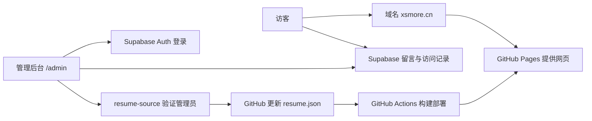

# GitHub + Supabase 在线简历完整 SOP

适用于本项目：Vue 3 + TypeScript 简历、留言板、在线编辑后台和访问统计。按首次搭建顺序说明；当前网站已完成配置，不需要重新创建项目或重复初始化。

## 1. 架构与最终结果

| 部分 | 负责什么 | 本项目 |
| --- | --- | --- |
| GitHub 仓库 | 保存代码、简历内容和修改历史 | `oii2659/profile`，分支 `main` |
| GitHub Actions | 收到提交后检查、构建、部署 | `.github/workflows/static.yml` |
| GitHub Pages | 托管生成的 HTML、CSS、JS | `https://xsmore.cn/` |
| Vue 管理界面 | 登录、编辑、留言管理、访问统计 | `https://xsmore.cn/admin` |
| Supabase Auth | 验证管理员邮箱和密码 | Authentication |
| Supabase Database + RLS | 保存留言、访问记录、管理员名单并控制权限 | PostgreSQL |
| Supabase Edge Function | 验证管理员，代其提交内容到 GitHub | `resume-source` |
| 域名与 DNS | 把自己的网址指向 GitHub Pages | `xsmore.cn` |

**简历内容存 GitHub；留言和访问记录存 Supabase。管理后台也是网页，权限和数据处理由 Supabase 执行。无需另买云服务器。**



## 2. PDF 转 Vue 3 + TypeScript，推送源代码

这部分简要处理：

1. 从 PDF 提取文字；扫描件先 OCR，人工核对姓名、日期、联系方式、项目和数字。
2. 将个人信息和正文放进 `src/data/resume.json`，用 Vue 组件和 CSS 排版。网页展示摘要和可展开详情，打印使用完整正文。
3. 加入留言组件、后台编辑界面、访问采集代码、SQL 脚本和发布函数。Supabase 不会自动生成这些业务功能。
4. 本地运行、构建检查后，提交到 GitHub 仓库。

```sh
npm ci
npm run dev
npm run build
git add .
git commit -m "Initialize resume website"
git push -u origin main
```

提交前确认 `.gitignore` 排除了 `.env.local`、`node_modules/`、`dist/` 和测试产物。Actions 会重新构建，不需要手工上传 `dist/`。

| 文件 | 用途 |
| --- | --- |
| `src/data/resume.json` | 简历内容唯一来源，后台保存修改这里 |
| `src/components/ReadingResume.vue`、`src/lib/reading.ts` | 网页摘要、折叠详情和流程展示 |
| `src/components/ResumeView.vue` | 完整简历打印与后台预览 |
| `src/components/Guestbook.vue` | 公开留言界面 |
| `src/admin/` | 登录、编辑、留言管理、统计页面 |
| `admin/index.html` | 后台独立入口，支持直接访问和刷新 |
| `supabase/` | 数据库初始化脚本和后端发布函数 |

转换完成后，以 `resume.json` 和在线后台为内容入口；不会自动回写最初的 PDF。新版 PDF 通过“打印 / 保存 PDF”生成。

## 3. 申请 Supabase：需要创建和保存什么

1. 注册并登录 [Supabase](https://supabase.com/)。
2. 创建或选择 Organization，点击 New project。
3. 填写项目名称，选择 Region，设置数据库密码，选择套餐并创建。
4. 等待项目准备完成，在 Connect / Settings / API Keys 等入口获取连接信息。菜单名称可能随控制台版本调整。

| 信息 | 获取位置 | 用途 |
| --- | --- | --- |
| Project URL | 项目连接信息或 API 设置 | 前端连接 Supabase |
| Publishable key / 旧版 anon key | API Keys | 浏览器使用的公开客户端密钥 |
| Project ref | 项目标识 | CLI 关联和部署 |
| Database password | 创建项目时设置 | 数据库直连及部分 CLI 操作 |
| 管理员邮箱、密码 | 稍后在 Authentication 创建 | 网站后台登录 |

本项目：

- Project URL：`https://jbptvcyfkmxrlxxgugxi.supabase.co`
- Project ref：`jbptvcyfkmxrlxxgugxi`

**数据库密码、网站管理员密码、Supabase 账号密码是三种不同凭据。** Publishable / anon key 可以进入前端；`service_role`、secret key 和 GitHub 写入 token 只能放在后端。

无需购买 Supabase 的自定义 API 域名。自己的网页域名在域名注册商购买。

## 4. 创建管理员账号，初始化数据库

### 4.1 创建登录用户

Supabase → Authentication → Users → Add user / Create user：

1. 填写管理员邮箱和密码。
2. 确保邮箱已确认；控制台直接创建时可使用自动确认选项。
3. 本项目管理员邮箱：`2704344268@qq.com`。
4. 仅站长使用登录，可在 Auth 设置中关闭公开新用户注册。

**Auth 用户只是登录身份，还需要加入 `site_admins` 才拥有管理权限。**

### 4.2 在 SQL Editor 执行脚本

SQL Editor 初始空白是正常的。点击 New query，粘贴仓库脚本的完整内容，再点击 Run。创建 Supabase 项目或推送 GitHub 不会自动执行 SQL。

以下两种方式任选一种：

**方式 A：本项目合并脚本。** 先创建并确认上述邮箱，然后运行 `supabase/setup-owner.sql`，一次配置留言、统计、权限并按邮箱授权。复用给其他人时，要替换脚本中的所有管理员邮箱后再运行。

**方式 B：通用分步配置。**

1. 先运行 `supabase/guestbook.sql`。
2. 再运行 `supabase/admin.sql`。
3. 在 Authentication → Users 复制管理员 UUID，再执行：

```sql
insert into public.site_admins (user_id)
values ('替换为管理员的 Auth 用户 UUID')
on conflict do nothing;
```

脚本会创建或配置：

| 对象 | 用途 |
| --- | --- |
| `message` 表 | 留言正文、时间和隐藏状态 |
| `site_admins` 表 | 管理员 Auth 用户 UUID 名单 |
| `page_views` 表 | 访问时间、页面、来源、设备、匿名会话 |
| `is_site_admin()` | 判断当前登录用户是否是管理员 |
| `record_page_view()` | 接收匿名访问记录 |
| `admin_visit_summary()` | 返回 7 / 30 天统计 |
| RLS 和权限规则 | 访客只能读公开留言、提交留言；管理员才能管理和查看统计 |
| Realtime 发布配置 | 留言变化时通知前端刷新 |

运行成功后，在 Table Editor 检查三张表，并确认 `site_admins` 中有自己的 UUID。若以后重跑 `guestbook.sql`，需紧接着运行 `admin.sql`，保留后台权限规则。

## 5. 配置本地前端连接

复制 `.env.example` 为 `.env.local`：

```dotenv
VITE_SUPABASE_URL=https://jbptvcyfkmxrlxxgugxi.supabase.co
VITE_SUPABASE_ANON_KEY=填写该项目的publishable或anon_key
VITE_ENABLE_ANALYTICS=true
```

统计数据库配置好后才设 `VITE_ENABLE_ANALYTICS=true`。修改本地环境变量后重启 `npm run dev`。

先检查简历和留言可读、`/admin` 能登录并验证权限。此时还没有配置 GitHub 写入接口，保存发布将在下一步接通。

## 6. 申请 GitHub 写入 token

用途：让 Supabase 后端代管理员修改 GitHub 中的 `src/data/resume.json`。

GitHub **个人账号** → Settings → Developer settings → Personal access tokens → Fine-grained tokens → Generate new token：

| 项目 | 设置 |
| --- | --- |
| Token name | 如 `resume-admin-publish` |
| Expiration | 选择到期时间，记录后续更换日期 |
| Resource owner | 拥有仓库的个人或组织 |
| Repository access | Only select repositories，选择 `oii2659/profile` |
| Repository permissions → Contents | **Read and write** |
| Metadata | 必需的 **Read-only** 权限，用于读取仓库基本信息 |

生成后立即保存 token，通常只显示一次。组织仓库可能还需审批。无需授予 Actions / Workflows 写权限。

这里申请的个人 token 用于后台发布。它与 Actions 运行时自动提供的 `GITHUB_TOKEN` 不是同一份凭据；不要将临时工作流 token 用作 Supabase 的长期凭据。

## 7. 配置 Supabase Secrets，部署发布接口

### 7.1 后端 Secrets

Supabase 项目 → Edge Functions → Secrets，添加：

| 名称 | 本项目值 |
| --- | --- |
| `GITHUB_TOKEN` | 上一步生成的 Fine-grained token |
| `GITHUB_REPOSITORY` | `oii2659/profile` |
| `GITHUB_BRANCH` | `main` |
| `ALLOWED_ORIGINS` | `https://xsmore.cn,https://www.xsmore.cn,https://oii2659.github.io,http://127.0.0.1:5175` |

`ALLOWED_ORIGINS` 是允许调用保存接口的网站来源。只写协议、域名和必要的端口，不带 `/admin`、`/profile/` 或末尾斜杠，多项用英文逗号分隔。

本地地址用于调试，端口以实际启动地址为准；`localhost` 和 `127.0.0.1` 是不同来源。线上使用不依赖本地地址。

托管函数环境已提供本代码使用的 `SUPABASE_URL` 和 `SUPABASE_SERVICE_ROLE_KEY`，不要复制到前端。

### 7.2 部署函数代码

在项目根目录执行：

```sh
npx supabase login
npx supabase link --project-ref jbptvcyfkmxrlxxgugxi
npx supabase functions deploy resume-source --project-ref jbptvcyfkmxrlxxgugxi
```

`login` 按 CLI 提示登录；`link` 关联目标项目，若提示数据库密码，填写创建项目时设置的密码。CLI 登录凭据不用写入网页。

部署后确认 Edge Functions 列表存在 `resume-source`。只有 Secrets、没有部署代码，保存接口仍不能工作。

本项目 `supabase/config.toml`：

```toml
[functions.resume-source]
verify_jwt = false
```

这是本项目的实现要求：关闭网关默认 JWT 检查后，函数内部仍调用 `auth.getUser()` 验证用户，再查询 `site_admins`，以兼容公开客户端密钥。不要把这项配置单独套用到没有内部鉴权的函数。

函数只修改 `src/data/resume.json`，并检查旧版本 SHA，防止覆盖并发修改。修改函数代码后需重新部署；GitHub Pages 工作流不会自动部署 Supabase 函数。

## 8. 配置 GitHub Actions Secrets 和 Variables

进入 **GitHub 仓库** → Settings → Secrets and variables → Actions。

在 **Secrets → New repository secret** 添加：

| 名称 | 值 |
| --- | --- |
| `VITE_SUPABASE_URL` | Supabase Project URL |
| `VITE_SUPABASE_ANON_KEY` | 同一项目的 publishable / anon key |

在 **Variables → New repository variable** 添加：

| 名称 | 值 |
| --- | --- |
| `VITE_ENABLE_ANALYTICS` | `true` |

本地 `.env.local` 不会自动上传，必须在 GitHub 再配置一次。工作流分别从 `secrets.*` 和 `vars.*` 取值，要放在对应标签里。

这些值在构建时进入网页。修改后必须重新部署才能生效；任何 `VITE_` 变量都不能填写 GitHub 写入 token 或 Supabase 后端密钥。

## 9. 启用 GitHub Pages 和自动部署

### 9.1 Pages 设置

仓库 → Settings → Pages → Build and deployment：

- **Source 选择 GitHub Actions**。
- 若仓库禁用了 Actions，在 Settings → Actions → General 启用所需 Actions。
- 当前发布分支为 `main`；环境规则若要求审批，部署时按要求批准。

### 9.2 工作流文件

使用仓库现有的 `.github/workflows/static.yml`，完整流程为：

```text
推送 main / 手动 Run workflow
→ checkout 仓库
→ 安装 Node.js 20
→ npm ci
→ npm run test:db
→ npm run build（注入 Supabase 配置）
→ configure-pages
→ upload-pages-artifact（上传 dist）
→ deploy-pages（发布网站）
```

其中必须配置：

```yaml
on:
  push:
    branches: ["main"]
  workflow_dispatch:

permissions:
  contents: read
  pages: write
  id-token: write
```

构建步骤从 GitHub 配置注入：

```yaml
env:
  VITE_SUPABASE_URL: ${{ secrets.VITE_SUPABASE_URL }}
  VITE_SUPABASE_ANON_KEY: ${{ secrets.VITE_SUPABASE_ANON_KEY }}
  VITE_ENABLE_ANALYTICS: ${{ vars.VITE_ENABLE_ANALYTICS }}
```

工作流使用 checkout、setup-node、configure-pages、upload-pages-artifact、deploy-pages 等官方 Actions。复制完整文件即可，不要只复制上面的配置片段。

### 9.3 触发与检查

推送后进入仓库 Actions → Deploy Vue to Pages，查看各步骤：

- **Success**：本次部署成功。
- **Failure**：打开失败步骤日志，修复后重新运行。
- **Queued / In progress**：仍在排队或部署。

工作流已提交后，也可在 Actions 页面点击 **Run workflow → main**。GitHub 有提交记录不代表部署已经完成。

## 10. 域名申请、DNS、HTTPS

域名在注册商购买，例如阿里云、腾讯云或 Cloudflare Registrar；不是在 Supabase 购买。

### 10.1 添加 DNS

在 `xsmore.cn` 的 DNS 管理中添加：

| 类型 | 主机记录 | 记录值 |
| --- | --- | --- |
| A | `@` | `185.199.108.153` |
| A | `@` | `185.199.109.153` |
| A | `@` | `185.199.110.153` |
| A | `@` | `185.199.111.153` |
| CNAME | `www` | `oii2659.github.io` |

`@` 代表根域名；四条 A 记录指向 GitHub Pages 多个服务地址。`www` 的 CNAME 让 `www.xsmore.cn` 指向 Pages，记录值不带协议或仓库路径。

### 10.2 GitHub 绑定

1. 在 GitHub 账号 Settings → Pages，可按提示添加 TXT 记录验证域名所有权。
2. 仓库 Settings → Pages → Custom domain 填 `xsmore.cn`，保存。
3. 等待 DNS 检查和 HTTPS 证书准备完成。
4. 开启 **Enforce HTTPS**。
5. 检查根域名可访问、`www` 按 Pages 设置跳转到主域名。

此项目使用自定义 Actions 部署，域名在 Pages 设置中绑定，不依赖手工提交构建目录中的 CNAME 文件。

### 10.3 部署路径与 /admin

本项目 Vite 使用 `base: '/'`，匹配 `https://xsmore.cn/` 根路径；同时构建首页和 `admin/index.html`。GitHub Pages 因而能直接打开和刷新后台。浏览器把 `/admin/` 规范为 `/admin`，旧 `/#/admin` 也会转换。

若复用项目但暂不绑定域名，默认地址可能是 `https://用户名.github.io/仓库名/`。这种子路径部署需要同时调整 Vite base、后台路径和返回首页的链接，不能直接照搬当前根路径配置。

## 11. 域名需要加入 Supabase 哪些位置

| 配置位置 | 本项目设置 | 作用 |
| --- | --- | --- |
| 注册商 DNS + GitHub Pages | `xsmore.cn` 指向 Pages | 让域名打开网站 |
| Supabase Auth → URL Configuration | Site URL：`https://xsmore.cn`；Redirect URLs 按需要加入 `https://xsmore.cn/admin` 和本地后台地址 | 邮件确认、密码重置、OAuth 等流程的返回地址 |
| Supabase Edge Functions → Secrets | `ALLOWED_ORIGINS` 包含 `https://xsmore.cn` | 允许该网站调用保存接口 |

当前后台使用邮箱密码登录，没有邮件或 OAuth 回调，因此 **Redirect URLs 不是普通密码登录的域名开关**。留言和访问统计的权限由身份、表权限及 RLS 控制，也不由保存接口的 `ALLOWED_ORIGINS` 控制。

更换域名时：更新 DNS、Pages Custom domain、`ALLOWED_ORIGINS`，核对 Auth 返回地址。Supabase 项目 URL、数据库及已有留言不需要迁移。

## 12. 管理后台具备哪些条件才可用

| 功能 | 必要条件 |
| --- | --- |
| 登录 | `/admin` 界面 + 前端 Supabase 配置 + 已确认 Auth 用户 + `site_admins` 授权 |
| 编辑简历 | 富文本编辑器 + 发布接口读取 GitHub 内容 |
| 保存并发布 | `resume-source` 已部署 + Secrets 正确 + token 有 Contents 写权限 + 分支允许提交 |
| 自动更新网页 | Actions 工作流 + 构建配置 + Pages 启用 |
| 留言管理 | `message` 表 + 管理员权限规则 + 管理界面 |
| 访问统计 | `page_views` 和函数 + 前端采集 + `VITE_ENABLE_ANALYTICS=true` |

访问 `https://xsmore.cn/admin` 登录。编辑时输入先暂存当前浏览器，点击 **保存并发布** 才写入 GitHub，随后查看提交记录和发布进度。

在线后台改的是简历内容和基础格式，整体布局、颜色和组件结构仍在 Vue / CSS 中修改。分支保护若禁止直接提交 main，应按仓库要求改成 PR 发布，扩大 token 权限不能替代分支规则。

## 13. 上线验收

1. 首页内容、折叠详情、手机显示、打印正常。
2. 直接打开 `/admin` 并刷新，无 404。
3. 管理员可登录并进入编辑、留言管理、访问统计；非管理员不能管理。
4. 修改一处真实内容并保存，GitHub 出现 `Update resume from admin editor`，只修改 `src/data/resume.json`。
5. 等待对应 Actions 成功，刷新首页确认内容更新。
6. 测试留言发布、后台隐藏、恢复和删除。
7. 用普通访客页面访问一次，再刷新后台统计。测试访问也可能计入真实记录。

统计只能从启用后累计；DNT、隐私设置、拦截工具和网络失败可能导致漏记。会话数不等于真实人数，当前不记录姓名或 IP。

## 14. 日常修改与维护

| 修改内容 | 操作 |
| --- | --- |
| 简历文字与基础格式 | 后台修改 → 保存并发布 → 等待 Actions 成功 |
| 页面布局、颜色、组件 | 本地先 git pull → 修改代码 → 验证 → 推送 main |
| 留言、访问统计 | 管理后台直接操作 Supabase，无需部署 |
| 前端 Supabase 配置 | 修改 GitHub Actions Secrets / Variables → 重新部署 |
| 发布函数代码 | 修改函数 → supabase functions deploy resume-source |
| GitHub token 到期 | 新建 token → 替换 Supabase Secret GITHUB_TOKEN |
| 更换管理员 | 创建并确认新 Auth 用户 → UUID 加入 site_admins；按需移除旧 UUID |
| 在线编辑后继续本地开发 | 先 git pull，同步后台产生的新提交 |

## 15. 常见问题定位

| 现象 | 优先检查 |
| --- | --- |
| SQL Editor 空白 | New query，粘贴脚本，再 Run |
| 登录成功却无权限 | site_admins 是否有该 Auth 用户 UUID |
| 后台 404 | 是否构建部署 admin/index.html，base 是否匹配路径 |
| 提示未配置 Supabase | Actions 两项 Secret、修改后是否重新构建 |
| 保存提示来源不允许 | ALLOWED_ORIGINS 的协议、域名、端口 |
| 保存提示未配置 GitHub | Edge Function Secrets 是否完整，函数是否部署 |
| GitHub 拒绝保存 | token 到期、仓库选择、Contents 权限、组织审批、分支限制 |
| 保存提示版本冲突 | 下载草稿，再加载远端最新内容并合并 |
| 保存成功但网站未更新 | 对应 Actions 是否成功、是否仍在部署、浏览器缓存 |
| 统计为 0 或读取失败 | 统计变量、采集请求、SQL 函数、管理员权限、网络 |
| 新域名打不开 | DNS、Pages Custom domain、HTTPS 证书 |

**内容发布链路：后台编辑 → Supabase 校验并提交 → GitHub 版本记录 → Actions 构建 → Pages 更新。留言和统计直接走 Supabase 数据库。**
